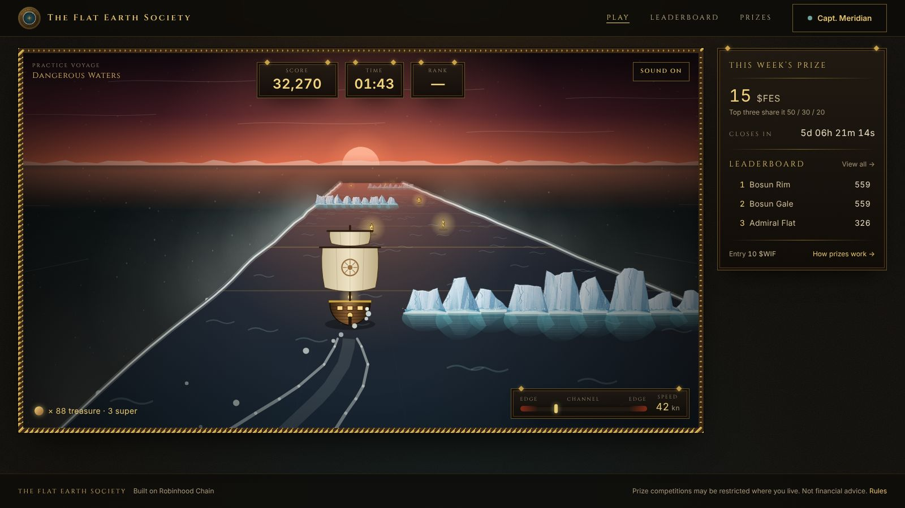
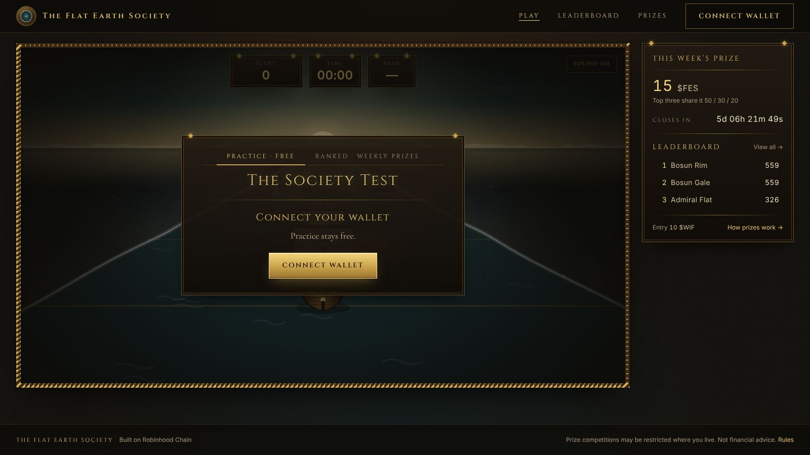
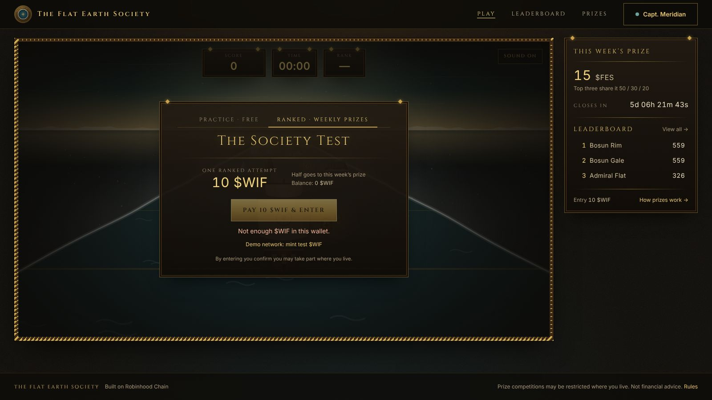
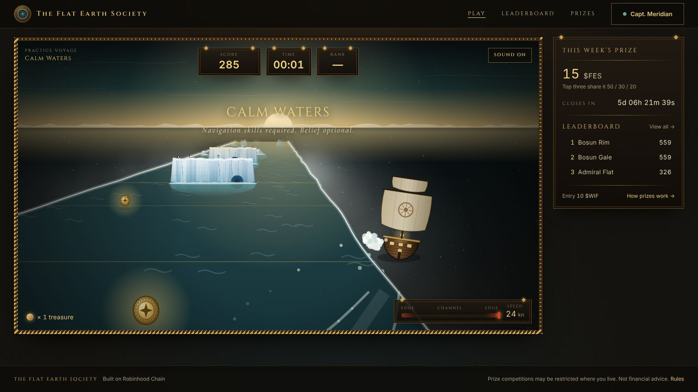
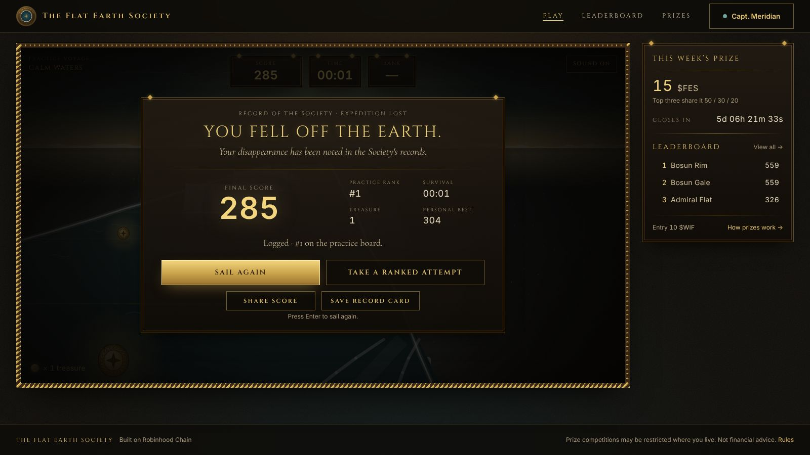
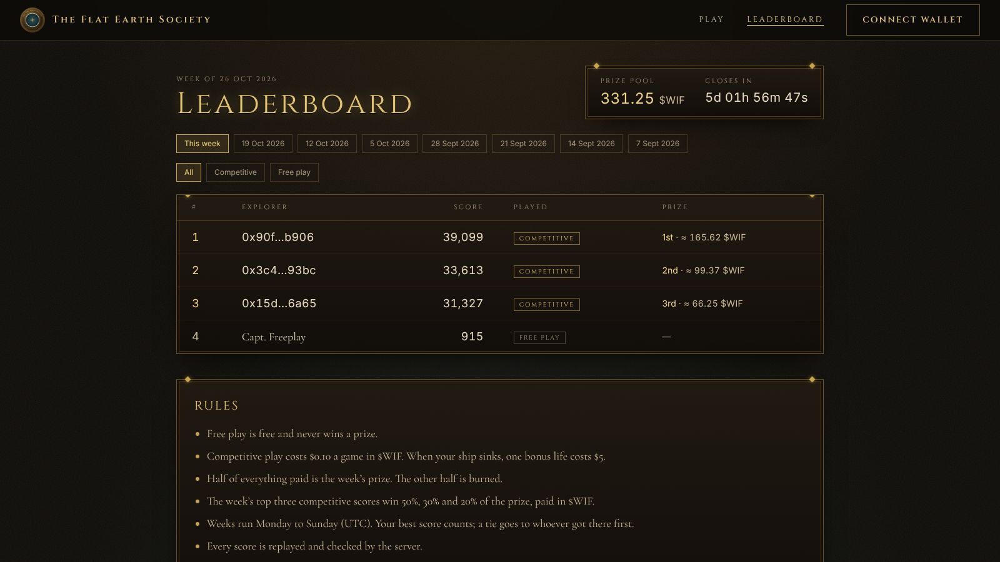
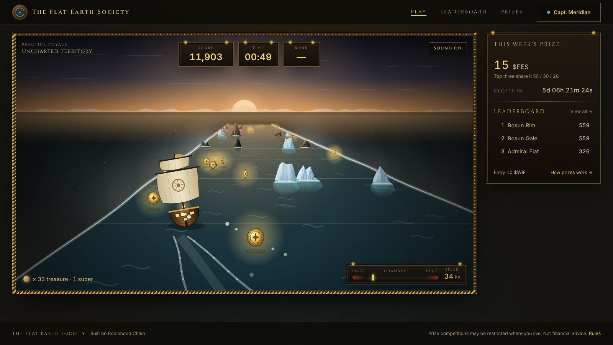
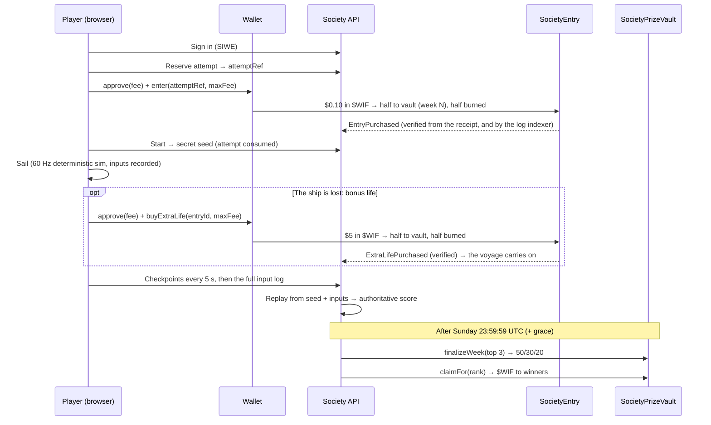

# The Flat Earth Society — The Society Test

> *The Truth Lies at the Edge.*

A desktop browser arcade game on **Robinhood Chain**, in the spirit of an endless runner. Your small sailing ship races straight down the last charted channel of the flat Earth, faster and faster; you slide it left and right with **← →** or **A / D**. Dodge rows of rocks and icebergs, sea gates and slaloms, kraken and the leviathan, wrecks, whirlpools and the Colossus, grab the treasure, and above all do not go over the Edge of the World on either side.

Anyone can start **free play** straight away, as a guest. Adding a name (connect a wallet, sign a free message, pick a unique name) puts free‑play scores on the weekly leaderboard beside competitive ones, so everyone can see where they would place; free play never wins anything. A **competitive game costs $0.10 in $WIF**, and only competitive scores compete for prizes. When the ship is lost, the player may buy **one bonus life for $5** and carry on. Exactly **50 %** of everything paid funds the weekly prize, paid **in $WIF**, **50 / 30 / 20**, to the three highest **server‑verified** scores of the week; the other **50 % is burned**. The fees follow the market price of $WIF, within limits fixed onchain.



| | |
|---|---|
|  |  |
|  |  |
|  |  |

---

## What is in this repository

| Path | What it is |
|---|---|
| [`packages/game-core`](packages/game-core) | The game itself. A **deterministic simulation** (fixed 60 Hz timestep, seeded RNG, engine‑independent maths) shared by the browser and the server. Also contains difficulty, the fair course generator (every row provably passable), scoring, replay verification, anomaly heuristics and balancing bots. |
| [`apps/web`](apps/web) | Next.js 16 / React 19 / Tailwind 4 site with wagmi + viem. Includes a real‑time 3D renderer (WebGL with three.js: a reflective animated sea, sky and stage lighting, long shadows, procedural 3D hazards, bloom), with the original Canvas‑2D renderer as a fallback, procedural WebAudio sound, and four pages: the game itself on the home page (add your name, then free or competitive play; short of $WIF, buy it on Uniswap, which opens in a window of its own over the game), the leaderboard (competitive and free play ranked together, and past winners), the game rules, and the lore (the world behind the game, from the Society's records). There is also an admin console. |
| [`apps/server`](apps/server) | Fastify API on PostgreSQL (or embedded PGlite for development). Covers Sign‑In with Ethereum, onchain payment verification and log indexing (entries and bonus lives), ranked sessions with server‑side replay, the price service that keeps the fees at their dollar prices, the leaderboard, live updates over SSE, the attempt‑restoration policy, anomaly review and weekly settlement. |
| [`contracts`](contracts) | Foundry project: `SocietyEntry` (WIF entries and bonus lives, exact 50/50 split, bounded market re‑pricing, buyer price limits), `SocietyPrizeVault` (weekly pools paid in $WIF, 50/30/20 finalization, claims; optionally a second prize token through `FixedRateConverter` / `UniswapV3Converter`), plus 173 tests including fuzz and invariants. |
| [`packages/shared`](packages/shared) | Contract ABIs, competition‑week math (identical onchain), chain definitions and API types. |
| [`docs`](docs) | Design and operations documents (see below). |

## Quick start (local, everything included)

Requirements: Node ≥ 20.10, [Foundry](https://book.getfoundry.sh/) (`forge`, `anvil`).

```bash
npm install
git submodule update --init --recursive        # forge-std + OpenZeppelin

# 1. A local chain with the contracts and a mock $WIF
./scripts/local-chain.sh

# 2. The Society's offices (API) — embedded Postgres, local chain
CHAIN_ID=31337 RPC_URL=http://127.0.0.1:8545 \
DEPLOYMENT_FILE=contracts/deployments/31337.json \
SETTLER_PRIVATE_KEY=0xac0974bec39a17e36ba4a6b4d238ff944bacb478cbed5efcae784d7bf4f2ff80 \
ADMIN_ADDRESSES=0xf39Fd6e51aad88F6F4ce6aB8827279cffFb92266 CONFIRMATIONS=1 \
PRICE_FEED=fixed WIF_USD=0.008 \
npm run dev -w @fes/server

# 3. The website
NEXT_PUBLIC_CHAIN_ID=31337 NEXT_PUBLIC_RPC_URL=http://127.0.0.1:8545 \
NEXT_PUBLIC_API_URL=http://localhost:4000 npm run dev -w @fes/web
```

Open <http://localhost:3000>: the game is the home page. Practice works straight away as a guest. To record practice scores or play ranked, import an anvil development key into a browser wallet, then connect, sign in and choose a name. For ranked play, add the local network (chain id 31337), switch the game to the **Ranked** tab and use **“Demo network: mint test $WIF”**. The private keys above are anvil's public development keys; never use them anywhere else.

Practice and the leaderboards also work without a chain: run the server with `CHAIN_MODE=disabled` (signing in needs only a wallet signature).

## Tests

```bash
npm test -w @fes/game-core        # 53 tests: determinism, steering, course fairness, the bonus life, verification, performance
npm test -w @fes/server           # 48 tests: SIWE, payments, bonus lives, replay verification, tampering, pricing, restoration, review, settlement
cd contracts && forge test         # 173 tests incl. fuzz and invariant suites
npm run e2e -w @fes/server        # against anvil + deployed contracts: re-price → pay → play → bonus life → verify → finalize → pay out
npm run balance -w @fes/game-core # survival-time distributions for bots of different skill
```

The onchain end‑to‑end run asserts every amount against the contracts. The price service re‑prices the fees for $WIF at $0.008 (12.5 $WIF a voyage, 625 $WIF a bonus life). Three players pay, one buys a bonus life when the ship is lost and sails on, and the server verifies all three voyages. The vault holds exactly half of the 662.5 $WIF paid, 331.25 $WIF, which is paid 165.625 / 99.375 / 66.25. A second finalization is refused onchain.

## How it fits together



## Documentation

- [Game design & balancing](docs/GAME_DESIGN.md): mechanics, difficulty progression, the fairness rules hazards must pass, anti‑farming, and bot balancing results.
- [Economy, pricing & settlement](docs/ECONOMY.md): the dollar prices and how they follow $WIF, the bonus life, rounding, rollover, what administrators can and cannot do.
- [Fair play: verification, anti‑cheat & the attempt‑restoration policy](docs/FAIR_PLAY.md)
- [Architecture](docs/ARCHITECTURE.md): determinism, data model, API, jobs.
- [Deployment](docs/DEPLOYMENT.md): Robinhood Chain testnet/mainnet, hosting, configuration, launch checklist.
- [Contracts](contracts/README.md): roles, flows, events, security notes.

## Status and launch prerequisites

- **Network parameters**: Robinhood Chain mainnet is chain id `4663`; the testnet is `46630`. These come from public sources at the time of writing. RPC URLs and explorers are configuration only and must be re‑checked against the official Robinhood Chain documentation before deploying (see [Deployment](docs/DEPLOYMENT.md)).
- **Token addresses are not hardcoded in the code.** Deployments take `WIF_TOKEN` from the environment. The project's mainnet $WIF is `0x5173b8ea6923c2d40267890d45c46a3480954773`; verify it on the explorer before deploying ([Deployment](docs/DEPLOYMENT.md#1-confirm-the-network-parameters-do-not-skip)). The deploy script refuses mock tokens on mainnet and tokens with no code.
- **Live‑value deployment requires** an independent contract audit, a real and liquid $WIF market for the price feed (or a maintained fixed price), and jurisdiction‑specific legal review of the paid‑entry prize competition, including the paid bonus life, with any eligibility restrictions it calls for. These are launch prerequisites; they do not change the game economy.
